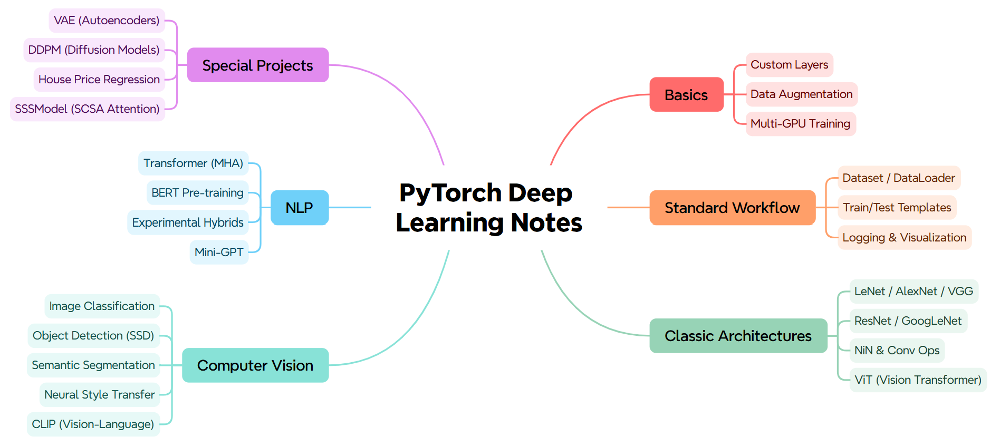

# PyTorch Deep Learning Notes 深度学习学习笔记（新手可轻松复现版）

[](https://github.com/Jackksonns)
[](https://github.com/Jackksonns/pytorch-deep-learning-notes/stargazers)

<div align="center">
  
</div>

## 🔥 News

- **2026.11.04** — 新增 [Mini-GPT](Mini-GPT/GPT.md)、[ViT](经典网络架构/ViT/ViT.md)、[CLIP](CLIP/CLIP.md) 和 [DDPM](自编码器/DDPM/DDPM.md) 学习模块。

---

## 项目概述

本仓库整理了个人学习 PyTorch 与深度学习过程中的笔记和代码实践，内容涵盖基础训练流程、经典神经网络、计算机视觉（CV）、自然语言处理（NLP）、多模态学习与生成模型。部分代码参考并改进自李沐老师的《动手学深度学习》和小土堆的 PyTorch 教程。

具体而言，内容涵盖深度学习基础、计算机视觉（CV）、自然语言处理（NLP）以及各类经典与前沿模型的实现。

---

## 详细内容模块

### 1. 深度学习基础 (Deep Learning Basics)

- **`deep_learning_basic/`**：模型构建与训练的基础知识，包括自定义层、数据增广、参数管理及多 GPU 训练等。
- **`pytorch完整流程手搓basis/`**：完整的 PyTorch 训练流程，涵盖 `Dataset`、`DataLoader`、模型构建、损失函数、优化器与 TensorBoard 可视化。

### 2. 网络架构 (CNN & Vision Transformer)

位于 **`经典网络架构/`** 目录下：

- **LeNet-5**：经典卷积网络，用于手写数字识别。
- **AlexNet**：深度卷积网络的代表性架构。
- **VGG**：通过重复卷积模块构建深层网络。
- **NiN (Network in Network)**：引入 1×1 卷积与全局平均池化。
- **GoogLeNet**：使用 Inception 模块构建多分支网络。
- **ResNet**：通过残差连接训练更深的网络。
- **ViT (Vision Transformer)**：基于 Transformer 的图像分类模型。

### 3. 计算机视觉与多模态 (Computer Vision & Multimodal Learning)

- **图像分类**：
  - `图像分类CIFAR-10/`：CIFAR-10 图像分类入门。
  - `树叶分类Classify_leaves/`：Kaggle 树叶分类，包含 ResNet18、ResNet50 迁移学习。
  - `狗品种识别ImageNet_Dogs/`：基于预训练模型的细粒度分类。
- **目标检测**：
  - `SSD/`：手写 SSD 多尺度目标检测模型。
  - `Bounding_Box/`、`目标检测数据集及代码/`：边界框、锚框与 IoU 等基础知识。
- **语义分割**：`FCN/`，使用全卷积网络和转置卷积进行像素级预测。
- **图文对齐与检索**：**CLIP**，基于图文对比学习的视觉语言模型。
- **其他实验**：`风格迁移/`、`fine_tuning/`（ResNet18 热狗分类微调）。

### 4. 自然语言处理 (Natural Language Processing)

- **`transformer/`**：多头注意力机制（MHA）、位置编码等 Transformer 核心组件。
- **`bert/`**：BERT 预训练（`bert_pretrain.py`）与 SNLI 数据集微调（`bert_finetuning/`）。
- **Mini-GPT**：基于 Decoder-only Transformer 的自回归语言模型。
- **`explore1/`**：结合 Inception 与 Transformer Encoder/Decoder 的探索性架构。

### 5. 生成模型与其他实验 (Generative Models & Projects)

- **VAE**：变分自编码器，基于 MNIST 学习图像生成。
- **DDPM**：通过逐步加噪和去噪生成图像的扩散模型。
- **[SSSModel (SCSA Attention)](https://github.com/Jackksonns/SSSModel)**：自定义空间与通道注意力模块及相关训练代码。
- **`房价预测House_price_predict/`**：使用线性网络和多层感知机（MLP）完成基础回归任务。

---

## Quick Start

### 环境准备

建议使用 Conda 创建 Python 3.11 虚拟环境，并在仓库根目录安装依赖：

```bash
conda create -n dlnote python=3.11
conda activate dlnote
python -m pip install -r requirements.txt
```

> 注：请以对应模块的运行说明为准。

### 运行示例

**经典网络（LeNet）**：

```bash
cd 经典网络架构/LeNet
python LeNet.py
```

**新增模块的基础代码检查**（在仓库根目录执行）：

```bash
python Mini-GPT/GPT.py
python 经典网络架构/ViT/ViT.py
python CLIP/contrastive_loss.py
python 自编码器/DDPM/DDPM.py
```

PS：CLIP 的预训练模型推理需要额外下载模型权重。

---

## 学习总结

经过系统学习与大量练习，我把从基础概念、经典网络到实战任务的理解和实现整理成了这个仓库。写这些笔记的初衷是让自己把知识吃透，能上手改改代码，并把能直接运行、容易复现的代码分享给更多像我一样的学习者。

如果你正在学习深度学习或准备做项目竞赛or上手科研，这个仓库可以作为一个动手实践的起点：

- 每个模块都尽量提供了可运行的示例和详尽注释，便于快速上手；
- 代码风格保持模块化，方便拿来微调或二次开发；
- 也欢迎大家提出 issues、PR 或直接在 Discussions 里交流问题与改进建议。

希望你能拿走你需要的代码、跑通示例、并把你的经验回馈到仓库中，让它变得更好，也让更多人能更容易地上手深度学习。欢迎大家一起用、一起改、一起交流一起进步呀！

## To-do List

- 持续补充经典模型与前沿架构的实现。

## Acknowledgements

感谢以下开源资源与社区提供的学习参考：

- [李沐《动手学深度学习》](https://github.com/d2l-ai/d2l-zh)：课程内容、示例代码与 d2l 相关资源。
- [小土堆 PyTorch 教程](https://github.com/xiaotudui/pytorch-tutorial)：PyTorch 基础教学与代码示例。
- 开源社区及 Kaggle 项目：部分练习参考了公开实现，具体资料与引用见对应文件。

---

如果这个仓库对你有帮助，欢迎点个 ⭐ Star。

**Contact:** [Jackson ZHOU](https://github.com/Jackksonns)
